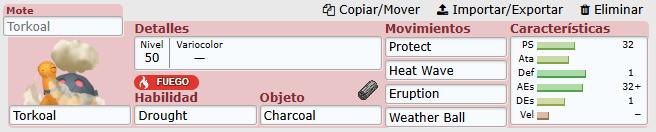

# TEAM BUILDER POKEMON

El proyecto trata de crear una aplicación web con las siguientes características:

## 1. Gestión de equipos

Pantalla donde podremos gestionar **dos equipos de 6 Pokémon cada uno**, con una columna por equipo. En cada columna podremos ver:

- El nombre de cada Pokémon.
- Una imagen del Pokémon (teniendo en cuenta si es variocolor o no).
- El nivel de cada Pokémon.
- Los tipos de cada Pokémon.
- Los movimientos de cada Pokémon.
- La habilidad de cada Pokémon.
- El objeto equipado de cada Pokémon.
- El sexo de cada Pokémon.

## 2. Acciones sobre los Pokémon

Cuando seleccionamos uno o varios Pokémon podremos realizar distintas acciones.

### 2.1. Añadir/Editar Pokémon

Cuando seleccionamos mediante un *check* únicamente un Pokémon, podremos elegir esta opción. Se mostrará una ventana nueva en la que podremos añadir el Pokémon que queremos y editar las siguientes características:

1. Los movimientos.
2. Los IVs y EVs (**31 IVs por defecto, 0 EVs por defecto**).
3. La habilidad.
4. La naturaleza del Pokémon.
5. El objeto equipado.
6. El nivel del Pokémon (**50 por defecto**).
7. El sexo.
8. La cantidad de PS que tiene el Pokémon, mostrando junto a la vida el porcentaje de PS correspondiente. Si se cambian los IVs de PS, se mantendrá el mismo porcentaje de vida, ajustando los PS actuales proporcionalmente.
9. Si el Pokémon es variocolor o no.

**Referencia visual:** modelo de Pokémon Showdown para implementar algo parecido.

#### Importación y exportación de Pokémon Showdown

Añadir una opción para importar Pokémon mediante el formato de pegado **Import/Export de Pokémon Showdown**, con las siguientes funcionalidades:

- Importar uno o varios Pokémon mediante texto de Showdown.
- Importar un equipo completo de hasta seis Pokémon.
- Exportar cualquiera de los dos equipos.
- Mostrar errores si el formato no es válido.
- Permitir elegir en cuál de los dos equipos se importa.

**Referencia visual:**

### 2.2. Borrar Pokémon

Cuando seleccionamos mediante un *check* únicamente un Pokémon, podremos elegir la opción de eliminar el Pokémon seleccionado.

### 2.3. Enfrentar Pokémon

Deberemos seleccionar **dos Pokémon de equipos diferentes** (uno de cada columna). Entonces podremos elegir la opción de enfrentarlos, que abrirá una ventana nueva con la **Calculadora de Daño Pokémon**.

La calculadora de daño debe ser parecida a [Pokémon Showdown Damage Calculator](https://calc.pokemonshowdown.com/) y tener también el aspecto de la imagen de referencia `PKMN_DMG_CALCULATOR.JPG`.

#### Factores que afectan al daño

La calculadora permitirá configurar, como mínimo:

- **Terreno:** electric, grassy, misty, psychic.
- **Clima:** sol, lluvia, tormenta de arena, nevada.
- **Pantallas defensivas:** Reflejo y Pantalla de Luz.
- **Modificadores de estadísticas:** de **-6 a +6** para cada Pokémon, reflejando cómo afectan a la potencia de los ataques.
- **Habilidades:** tener en cuenta las habilidades que potencian o atenúan los movimientos.
- **Golpe crítico:** opción para indicar si cada movimiento será crítico o no.
- **Tipo de combate:** dobles o singles, considerando los movimientos que afectan a más de un Pokémon.
- **Estados alterados:** quemado, paralizado, envenenado, envenenado gravemente, dormido o congelado.

El resto de factores que aparecen en la imagen de referencia se pueden añadir, pero por ahora no son prioritarios.

#### Motor de cálculo

Para realizar los cálculos de daño se utilizará el repositorio:

- [Smogon Damage Calculator](https://github.com/smogon/damage-calc)

La interfaz mostrará los **cuatro movimientos de cada Pokémon**, permitirá seleccionar el movimiento deseado y calcular el daño **en ambas direcciones**.

#### Orden de ataque

La calculadora deberá especificar cuál de los dos Pokémon atacaría primero teniendo en cuenta:

- La velocidad.
- La prioridad del movimiento.
- Las habilidades.
- Los objetos.
- Las condiciones del campo, por ejemplo, **Espacio Raro**.
- Los estados alterados, por ejemplo, la parálisis.
- La posibilidad de empate de velocidades (**Speed Tie**).

## 3. Fuente de datos e imágenes

Todos los datos de los Pokémon se recogerán mediante peticiones a:

- [PokéAPI](https://pokeapi.co/)

Los sprites podrán obtenerse de esta API. Como alternativa, se proporciona:

- [PokéAPI Sprites](https://pokeapi.github.io/sprites/#/pokemon/1)

## 4. Generaciones y mecánicas

El programa debe soportar **todas las generaciones disponibles en Pokémon** y las mecánicas deben ajustarse al modelo de **Pokémon Champion**.

## 5. Restricciones del editor

Por ahora, el editor **no permitirá asignar cualquier movimiento o habilidad** de la base de datos. Solo se podrán seleccionar:

- Los movimientos que pueda aprender cada Pokémon.
- Las habilidades que pueda tener cada Pokémon.

## 6. Almacenamiento

Los equipos se guardarán **localmente**.

## 7. Tecnologías recomendadas

Las siguientes tecnologías son recomendaciones, pero se podrán tomar otras decisiones técnicas:

- **React + TypeScript + Vite:** interfaz web, componentes y estructura del proyecto.
- **Tailwind CSS:** estilos y diseño adaptable.
- **PokéAPI:** información e imágenes.
- **@smogon/calc:** cálculos de daño.
- **localStorage:** almacenamiento inicial sin necesidad de backend.
- **Vitest:** pruebas automáticas de las reglas y de la integración con la calculadora.

## 8. Second Brain

> La información que creas la guardarás en el Second Brain en la sección de `Proyectos/TeamBuilderPokemonApp`.
